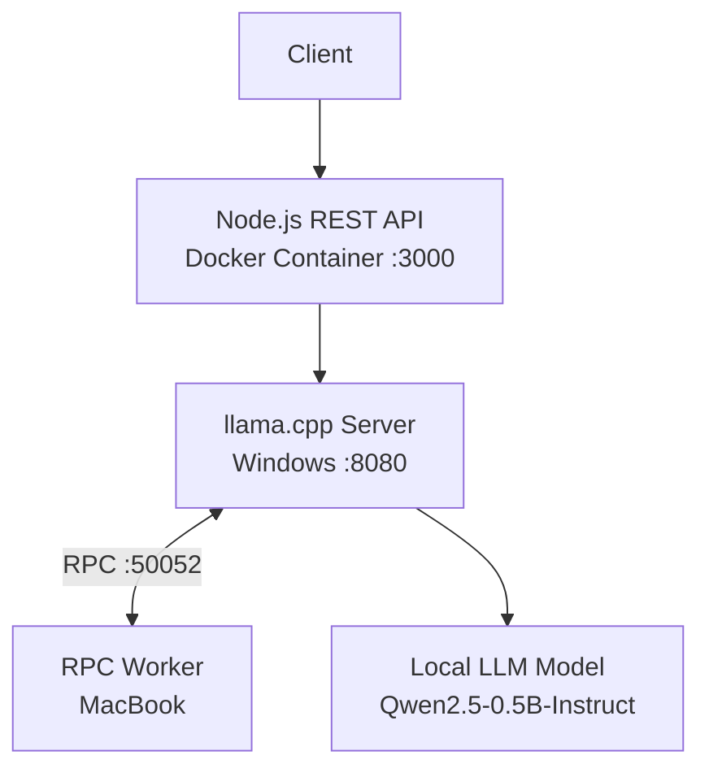

# Distributed LLM Inference System

A prototype for serving a locally hosted Large Language Model through a Dockerized Node.js API, with distributed inference tested using `llama.cpp` RPC across a Windows machine and a remote MacBook.

## Overview

This project explores how multiple computers can participate in local LLM inference using RPC-based compute offloading. A Node.js REST API provides an interface for sending prompts to the model server.

### Key Features

- Local inference using `llama.cpp`
- RPC-based compute offloading to a remote machine
- Dockerized Node.js API
- REST endpoint for text generation
- Health-check endpoint
- Windows-only versus distributed-inference benchmark
- Remote machine connectivity through Tailscale

## Architecture



**Important:** The Node.js API runs inside Docker. The `llama.cpp` inference server and Mac RPC worker run separately on their respective machines. RPC offloading is experimental in this prototype and did not improve generation speed in the measured test.

## Technology Stack

- **Backend:** Node.js, Express.js
- **Inference:** llama.cpp, GGUF model
- **Containerization:** Docker
- **Networking:** Tailscale, TCP/RPC
- **Model:** Qwen2.5-0.5B-Instruct, quantized GGUF

## Project Structure

```text
distributed-inference-api/
├── server.js
├── package.json
├── package-lock.json
├── Dockerfile
├── .dockerignore
├── .gitignore
└── README.md
```

The `llama.cpp` source and model files are managed separately from the API repository.

## Prerequisites

- Node.js and npm (for running the API outside Docker)
- Docker Desktop
- `llama.cpp` built with RPC support
- A compatible GGUF model file
- Tailscale installed on both machines for remote connectivity

## Setup

### 1. Start the RPC worker on the MacBook

Build `llama.cpp` with RPC support first, then start the RPC server. Replace the IP address with the Mac's reachable Tailscale IP if it differs.

```bash
cd ~/llama.cpp
./build/bin/ggml-rpc-server -H 100.71.94.26 -p 50052
```

Keep this process running while testing distributed inference.

**Security note:** RPC endpoints should only be exposed to trusted devices on a private network. Do not expose the RPC port publicly.

### 2. Start the llama.cpp server on Windows

Ensure the model file exists at the specified path and the Windows build supports RPC.

```powershell
cd C:\Users\kanni\llama.cpp

.\build\bin\Release\llama-server.exe `
  -m ".\qwen0.5b.gguf" `
  --host 0.0.0.0 `
  --port 8080 `
  -ngl 99 `
  --rpc 100.71.94.26:50052
```

Keep the server running. Confirm that the API is reachable locally before starting the Dockerized Node.js service.

### 3. Build the Node.js API image

Open a terminal in the `distributed-inference-api` directory.

```powershell
docker build -t distributed-inference-api .
```

### 4. Run the API container

```powershell
docker run --name distributed-inference-api `
  -p 3000:3000 `
  -e LLM_URL=http://host.docker.internal:8080 `
  distributed-inference-api
```

The API should now be accessible at `http://localhost:3000`.

## API Endpoints

### Health Check

`GET /health`

Example response:

```json
{
  "status": "ok",
  "service": "distributed-inference-api"
}
```

### Generate Text

`POST /generate`

Request:

```json
{
  "prompt": "Explain distributed computing in simple words."
}
```

Example response:

```json
{
  "response": "Distributed computing is..."
}
```

The generated response depends on the model output and may differ between requests.

### Test with PowerShell

```powershell
$body = @{
  prompt = "Explain distributed computing in simple words."
} | ConvertTo-Json

Invoke-RestMethod `
  -Uri http://localhost:3000/generate `
  -Method Post `
  -ContentType "application/json" `
  -Body $body
```

## Performance Evaluation

Initial measurements from the local test environment:

| Configuration | Generation speed |
|---|---:|
| Windows-only inference | 33.1 tokens/sec |
| Windows + Mac RPC | 0.7 tokens/sec |

The measured distributed configuration was significantly slower for generation. This highlights the overhead that can arise from RPC communication, network latency and workload partitioning.

These are preliminary measurements, not a controlled benchmark. Hardware conditions, prompt settings, model settings and repeated runs should be standardized before making broader performance claims.

## Limitations

- RPC-based inference did not improve generation speed in the current test.
- The API container, inference server and RPC worker are not yet deployed as a complete Kubernetes system.
- The prototype has not yet been validated with repeated controlled benchmarks.
- Authentication, production-grade observability and deployment automation are not included in the current implementation.

## Future Improvements

- Add structured request and inference logs.
- Run repeatable benchmarks with identical prompts and generation settings.
- Compare different RPC offloading configurations.
- Add request IDs, timeouts and more robust error handling.
- Add metrics and monitoring.
- Explore container orchestration with Kubernetes.

## Security

- Never commit model weights, access tokens, passwords or private environment files.
- Restrict RPC connectivity to trusted devices.
- Use private networking and appropriate firewall rules.
- Avoid exposing the inference server publicly without appropriate access controls.

## Disclaimer

This is an experimental distributed-inference prototype built using existing `llama.cpp` RPC functionality. It is not a custom LLM inference engine implemented from scratch.
